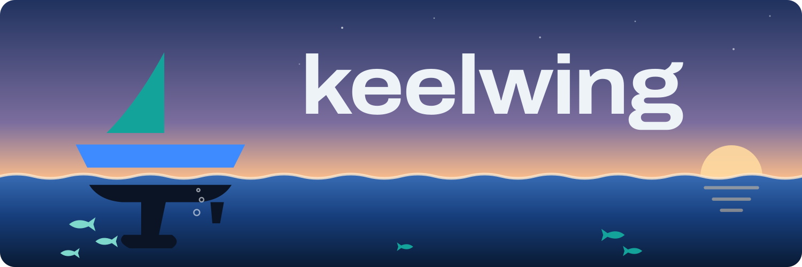

  

Open-source sessions, extensions and tools for Sailfish OS phones.

A sailing boat has three layers, and so do our projects. Each one runs on the phone you already have, next to
Sailfish OS, not instead of it.

| Layer | In the mark | Projects |
|---|---|---|
| **Air**: UI and UX | the sail | **[Seaglass](https://github.com/Keelwing/seaglass)**: widgets, glass, app search, notification badges, a richer task switcher and app animations for the stock home screen. [Website](https://keelwing.github.io/seaglass/) · [Download](https://github.com/Keelwing/seaglass/releases/latest) |
| **Surface**: modules that glide | the hull | **Sailyard**: a second session on a Sailfish OS phone, per user. Plasma Mobile and Plasma Desktop today, Phosh next |
| **Depth**: under the water | the keel | The runtime under the sessions: GPU, boot screen, the compositor hand-over. Tools for disk usage and monitoring come next |

Seaglass is out; the other repositories open one by one. More at [keelwing.github.io](https://keelwing.github.io/).

Everything here is free and stays free. If it helps you, a coffee on Ko-fi keeps the work going:

Sailfish OS and Jolla are trademarks of their owners; Keelwing is a community project, not made or endorsed by
them.
