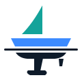

  <picture>
    <source media="(prefers-color-scheme: dark)" srcset="keelwing-mark-dark.svg">
    
  </picture>

<h1 align="center">Keelwing</h1>

Open-source sessions, extensions and tools for Sailfish OS phones.

A sailing boat has three layers, and so do our projects. Each one runs on the phone you already have, next to
Sailfish OS, not instead of it.

| Layer | In the mark | Projects |
|---|---|---|
| **Air**: UI and UX | the sail | **Seaglass**: home screen extensions for the stock Sailfish OS UI: folders, glass, search, badges, a richer task switcher, widgets |
| **Surface**: modules that glide | the hull | **Sailyard**: a second session on a Sailfish OS phone, per user. Plasma Mobile and Plasma Desktop today, Phosh next |
| **Depth**: under the water | the keel | The runtime under the sessions: GPU, boot screen, the compositor hand-over. Tools for disk usage and monitoring come next |

Early days: the repositories open one by one.

If the work helps you, you can support it on [Ko-fi](https://ko-fi.com/D31m05z).

Sailfish OS and Jolla are trademarks of their owners; Keelwing is a community project, not made or endorsed by
them.
